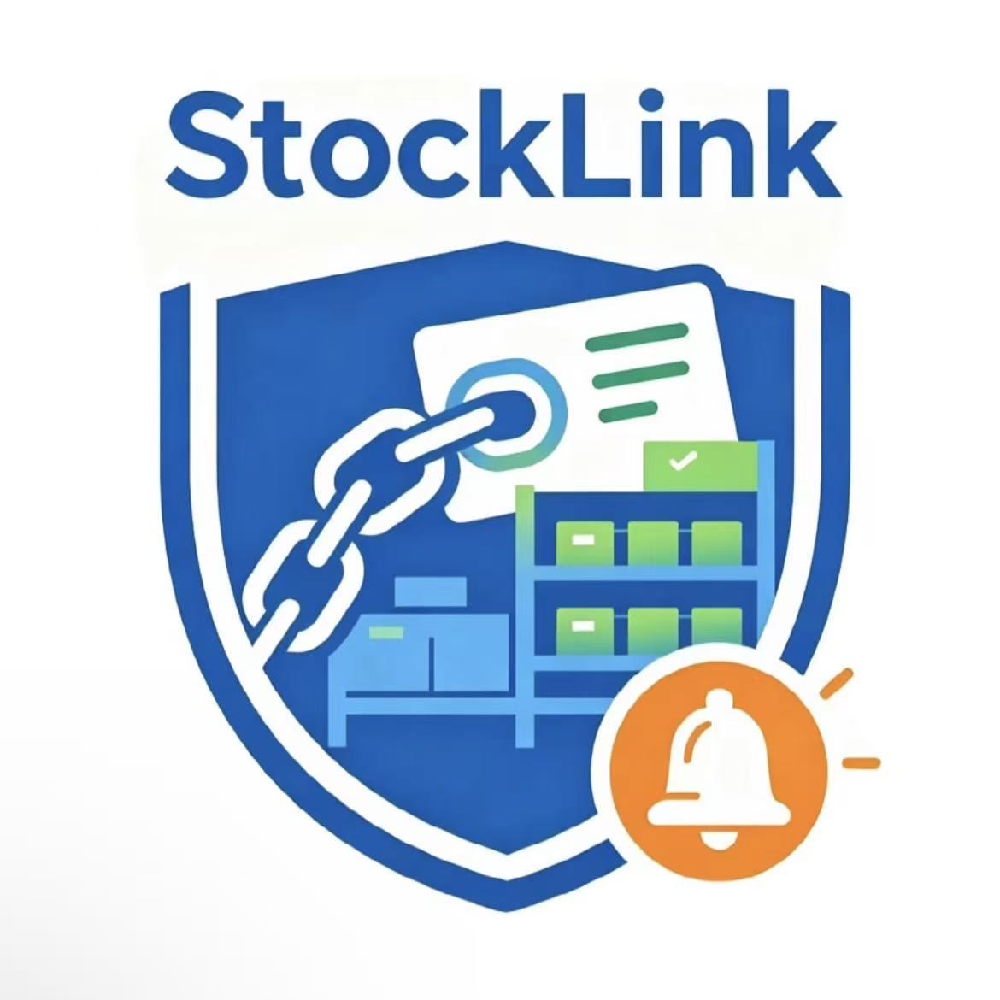

<p align="center"></p>

# StockLink

**Connect orders to stock. See risk early. Keep people in control.**

An inventory and order-management prototype for Malaysian micro and small businesses. The Kopi Corner demo connects confirmed orders, recipe quantities, on-hand inventory and incoming deliveries in an explainable seven-day stock forecast.

[Live demo](https://stock-link.replit.app/) · [Replit](https://replit.com/@WilliamWang185/StockLink) · [中文说明](docs/README.zh-CN.md) · [Demo guide](docs/demo-guide.md) · [Architecture](docs/architecture.md)

[](https://github.com/RM15-Refunders/StockLink/actions/workflows/ci.yml)

## Implemented features

| View | Current behavior |
|---|---|
| Overview | Seven-day forecast, risk explanations, open deliveries and human-reviewed suggestions |
| Orders | Create/edit drafts, confirm or cancel orders, edit per-drink recipes |
| Inventory | Edit stock, safety thresholds and baseline demand; record adjustments and inspect arithmetic |
| Deliveries | Review seeded purchase orders; receive quantities or cancel open deliveries |
| Activity | Browser-local changes and recommendation decisions |

**Scope:** synthetic, browser-local data persisted in localStorage. No authentication, shared business database, live AI, automatic purchasing or supplier messaging. Approving a suggestion records a decision only. API and database packages are scaffolding, not the persistence layer used by this interface.

## Run locally

Use **Linux x64** (Windows: WSL2), **Node.js 24**, and **pnpm 10.26.1**. Current native dependency overrides exclude other platforms; native Windows/macOS are not validated. Node.js 22.22 also passed the Replit build.

```sh
git clone https://github.com/RM15-Refunders/StockLink.git
cd StockLink
pnpm install --frozen-lockfile
PORT=3000 BASE_PATH=/ pnpm --filter @workspace/stocklink run dev
```

Open http://localhost:3000. Run commands from the root using pnpm; dependencies use workspace packages and a shared catalog.

```sh
pnpm run typecheck
PORT=3000 BASE_PATH=/ pnpm run build
PORT=3000 BASE_PATH=/ pnpm --filter @workspace/stocklink run serve
```

The full build includes type checks. Static output: `artifacts/stocklink/dist/public/`. Static hosting needs index.html fallback for client routes such as /orders. A build does not publish the live Replit deployment.

| Variable | Example | Purpose |
|---|---|---|
| PORT | 3000 | Required by Vite configuration; use an available positive port |
| BASE_PATH | / | Required URL base; use / for root hosting |

Set these before Vite starts. `.env.example` documents values; copying it alone does not export shell variables. The demo requires no API keys or DATABASE_URL.

## Forecast and stack

Projected stock = on hand − baseline demand − confirmed recipe demand + scheduled open deliveries. Draft/cancelled orders are excluded. Risk is checked before and after same-day arrivals. Safety stock is a warning threshold. Baseline is additional to confirmed demand.

Milk example: `30 − (12 × 3) = −6 L` before the day-3 delivery; 5 L safety is crossed in about 2.1 days. See [assumptions and limitations](docs/architecture.md).

| Component | Technology / role |
|---|---|
| UI | React 19, TypeScript 5.9, Vite 7, Tailwind CSS 4, Wouter, Lucide |
| Persistence | localStorage, key stocklink-demo-v1 |
| Tooling | pnpm workspaces and GitHub Actions |
| API / DB scaffold | Express health endpoint, generated clients and Drizzle/PostgreSQL; not integrated with demo stock workflows |
| AI / external services | Not integrated |

```text
artifacts/stocklink/        Main demo and brand assets
artifacts/api-server/       API scaffold
artifacts/mockup-sandbox/   Design sandbox
lib/                       Shared contracts, generated clients and DB scaffold
scripts/                   Workspace utilities
docs/                      Architecture, demo and competition reference
.github/                   CI and contribution templates
```

## Team and collaboration

**RM15 Refunders · Xiamen University Malaysia · Domain 2 — ALPHA RED**

Wang Yanfeng (@WilliamWang185), Liu Jiaming (@liujiaming-maker), Zhou Xiaduo (@XIA1969), Geng Ruixi (@Geng0119), Gao Zijun (@Skyler-Quinn). Primary alignment: SDG 8, targets 8.2 and 8.3.

[Team roles and preserved submission planning](docs/competition-reference.md) · [Contributing](CONTRIBUTING.md)

CI validates install, types and build. Use the [manual demo checklist](docs/demo-guide.md) for behavior. Future directions include business-rule tests, stronger validation, shared persistence/authentication, and optional human-reviewed AI order drafts. Replit usage evidence must accompany the declaration. Under orientation slide 29, RunPod is required for GPU training, fine-tuning or model inference; the current browser-only demo performs no GPU workload.

## License

StockLink is licensed under the [Apache License 2.0](LICENSE), as required by the SDC orientation repository rules. Copyright 2026 RM15 Refunders contributors. Third-party libraries retain their own licenses and notices; see [NOTICE](NOTICE).
