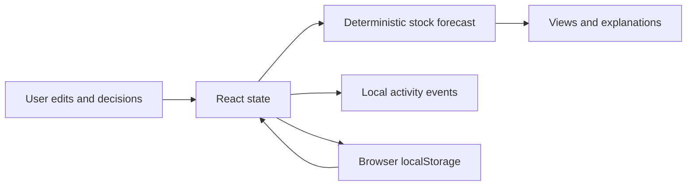

# Architecture and assumptions

The active demo lives in `src/artifacts/stocklink/src/App.tsx`. React state contains inventory, orders, deliveries, recipes, recommendations and events. localStorage (`stocklink-demo-v1`) persists state in the same browser. Wouter selects the five views.

The inventory/order flow does not call the API scaffold, database, AI model or supplier. The Express health endpoint, generated clients and Drizzle setup are extension scaffolding.

## Forecast rules

1. Start with on-hand stock. Subtract baseline consumption for elapsed days.
2. Apply recipe quantity times product quantity for confirmed orders on scheduled dates. Draft/cancelled orders contribute no demand.
3. Add open deliveries on scheduled dates. Current code counts overdue open deliveries at day zero; this optimistic assumption needs review before real use.
4. Check safety before and after same-day arrivals; a delivery must not hide an earlier shortage. Safety is a threshold, not additional demand.
5. Risk search samples seven days in 0.05-day increments; reported times are approximate.

Baseline consumption is additional to confirmed demand. If baseline already includes those orders, demand would be counted twice. Past orders are not re-applied to current on-hand stock by the future forecast.

Receiving an open delivery adds quantities to stock and changes its status so it is not counted again as incoming. Recommendation decisions record an event only. The seeded suggestion is not generated by AI or continuously regenerated.

## Seed examples

Milk: 30 L stock, 12 L/day baseline, 5 L safety and 48 L delivery on day 3. Before arrival, `30 - 12 * 3 = -6 L`; first detected below safety is about 2.1 days. Seed confirmed Long black orders consume no milk.

Beans on day 7: `8.4 - 1.15 * 7 - 36 * 0.018 + 6 = 5.702 kg`, above 2 kg safety. Chart lines are independently scaled; different ingredients do not share an absolute unit scale.

## Limitations

- No authentication, shared persistence, server backup or concurrency handling. Activity is editable local demo history, not a tamper-resistant audit log.
- Dates mix UTC date generation and local display. Persisted sample dates age; reset before a presentation and check midnight/time-zone behavior.
- Local storage, numeric inputs and random IDs need stronger validation for real operations. Monetary estimates use illustrative fixed prices.
- Static hosting needs fallback routing to index.html. Output is src/artifacts/stocklink/dist/public/.
- Vite needs PORT and BASE_PATH before configuration evaluation. CI checks install/types/build on Ubuntu x64; behavioral checks remain manual.
